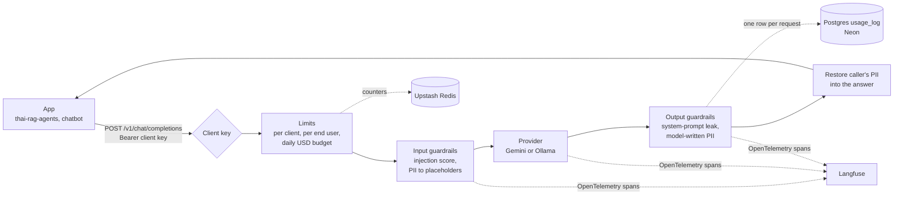

# Thai LLM gateway

An OpenAI-compatible gateway that sits between apps and the model providers (Gemini, Ollama). Every request goes through rate limits, a daily budget, Thai-aware PII redaction, a prompt-injection check and output checks, and leaves a trace and a cost record behind. [thai-rag-agents](https://github.com/WISHERCARTs/thai-rag-agents) and the portfolio chatbot will call their models through it.

> **Status (19 November 2026):** steps 1 and 2 of 4 are done: the proxy, limits, cost log, traces and guardrails. They are covered by 71 tests with fake providers (no API key needed) and a real Postgres in CI. It has not been deployed or called with a real Gemini key yet; that is step 3. The guardrail numbers below come from a hand-written set, read [what they mean](#guardrail-evaluation) before quoting them.

## What happens to a request



1. **Client key.** Each app has its own key (`Authorization: Bearer ...`), so limits and costs are per app.
2. **Limits.** A fixed window per client per minute, and per end user per minute and per day. The end user is the `x-end-user` header or the OpenAI `user` field (the demo backend sends the visitor's IP); it is stored only as a keyed hash. When the day's estimated spend reaches `DAILY_BUDGET_USD`, every request gets `429 daily_budget_exceeded` until 00:00 UTC.
3. **Input guardrails.** User and tool messages are scored for prompt injection; at the threshold (0.7) the request is refused with `400 prompt_injection` and never reaches the provider. Personal data in user, assistant and tool messages is swapped for placeholders like `[PHONE_1]`.
4. **Provider.** Gemini's and Ollama's OpenAI-compatible endpoints. 429 and 5xx answers are retried with backoff.
5. **Output guardrails.** An answer that repeats a long stretch of the system prompt is replaced and marked `finish_reason: content_filter`. Personal data the model wrote itself is masked as `[REDACTED_PHONE]`.
6. **Restore.** The caller's own values are put back where the model used the placeholders, so the user sees their own phone number while Gemini and the traces never did.

Response headers: `x-request-id`, `x-gateway-cost-usd`, `x-gateway-pii-redacted`, `x-gateway-injection-score`, `x-ratelimit-remaining-requests`.

## Design decisions

| Decision | Why |
|---|---|
| OpenAI-compatible API | Most SDKs and agent frameworks (including ADK through LiteLLM) can point at it by changing the base URL, and both upstreams already speak it. |
| Rules, not a model, for PII and injection | No extra model call, no added latency or cost, and every block names the rule that fired. The trade-off is lower recall on paraphrased attacks; the [evaluation](#guardrail-evaluation) shows where. |
| Redact, then restore | Redacting alone breaks answers like "I'll call you at [PHONE_1]". The mapping lives only in memory for the one request. |
| Thai ID numbers must pass the mod-11 checksum, cards the Luhn check | Order numbers and other 13- or 16-digit numbers are common in Thai text; the checksums keep them from being redacted. |
| Thai names only after a title (นาย, นางสาว, ด.ช., ...) | Thai has no capital letters or spaces between words. PyThaiNLP's tokenizer finds where the name ends, and titles inside words (นายกรัฐมนตรี, นางพยาบาล) are skipped. "คุณ" is left out because it also means "you". |
| Check the answer for system-prompt leaks | An injection the input rules missed usually shows up as the model repeating its instructions. |
| No streaming yet | The output checks need the whole answer. Streaming with a held-back buffer is possible later. |
| Upstash Redis for counters, Postgres (Neon) for the cost log | Cloud Run instances come and go, so counters cannot live in memory. Redis is the usual tool for counters; Postgres makes the cost report one SQL query (`usage_daily` view). Neon's free plan wakes on the first query instead of pausing the project, and the code only needs a `DATABASE_URL`, so any Postgres works. |
| Spans follow the OpenTelemetry GenAI conventions | The code depends only on OpenTelemetry; Langfuse is one OTLP endpoint and can be swapped by changing config. Only redacted text is put on spans. |

## Guardrail evaluation

`python -m evals.guardrails.run` scores the rules on [evals/guardrails](evals/guardrails): 30 sentences with labelled personal data, and 28 attacks against 24 normal questions (Thai and English). CI fails a pull request if a number falls below [baseline.json](evals/guardrails/baseline.json).

| Check | Result |
|---|---|
| PII precision | 1.00 (nothing wrongly redacted) |
| PII recall | 0.905 (19 of 21 values found) |
| Injection detection | 0.929 (26 of 28 attacks blocked) |
| Injection false blocks | 0.00 (0 of 24 normal questions blocked) |

What the misses are:
- Names written without a title ("ผมชื่อสมชาย", "คุณสมศรี") are not found.
- An attack in French and a polite paraphrase ("set aside the guidance you were given earlier") get through. A model-based classifier as a second stage would be the fix.

**Read these numbers carefully.** I wrote the sets while building the rules, so they show what the rules were designed to catch, not how they do on real traffic. A held-out set (for example from public prompt-injection datasets, translated to Thai) is part of step 4.

## Run it

```bash
python -m venv .venv && . .venv/bin/activate
pip install -r requirements-dev.txt
cp .env.example .env          # set GATEWAY_CLIENT_KEYS and GEMINI_API_KEY
uvicorn gateway.main:app --port 8080
```

```bash
curl localhost:8080/v1/chat/completions \
  -H "Authorization: Bearer change-me" -H "Content-Type: application/json" \
  -d '{"model": "gemini-2.5-flash", "messages": [{"role": "user", "content": "ดอยอินทนนท์สูงเท่าไร"}]}'
```

Any OpenAI client works:

```python
from openai import OpenAI

client = OpenAI(base_url="http://localhost:8080/v1", api_key="change-me")
client.chat.completions.create(model="gemini-2.5-flash", messages=[{"role": "user", "content": "สวัสดี"}])
```

Models: the Gemini names in `GEMINI_MODELS` (default `gemini-2.5-flash`, `gemini-2.5-flash-lite`) and any `ollama/<model>`. With empty Upstash and `DATABASE_URL` settings the gateway uses in-memory stores, which is fine for one local process. `docker compose up --build` runs it with Ollama next to it.

Tests and checks (no network, no keys):

```bash
pytest -q    # TEST_DATABASE_URL=postgresql://... also runs the Postgres test
ruff check . && ruff format --check .
python -m evals.guardrails.run --check
```

## Configuration

All settings are environment variables; see [.env.example](.env.example). On Cloud Run the secrets (`GATEWAY_CLIENT_KEYS`, `GEMINI_API_KEY`, `USER_HASH_SALT`, `UPSTASH_REDIS_REST_TOKEN`, `DATABASE_URL`, `LANGFUSE_SECRET_KEY`) come from Secret Manager. The `usage_log` table is in [db/migrations](db/migrations); apply it with `DATABASE_URL=... python -m gateway.migrate`.

Costs are estimated from the list prices in [gateway/pricing.py](gateway/pricing.py), even on the free tier, so the budget cap and the cost report show what the traffic would cost on a paid key. Check the prices against Google's pricing page before relying on them.

## Deploy (Cloud Run)

1. In Cloud Shell, in the gateway's project, run [scripts/gcp-setup.sh](scripts/gcp-setup.sh). It enables the APIs, creates the image repository and two service accounts (runtime and deployer), sets up Workload Identity Federation for this repository only, asks for each secret in a hidden prompt and stores it in Secret Manager, generates the client keys and the hash salt, and applies the database schema. It is safe to run again.
2. Put the three identifiers it prints into the `env` block of [deploy.yml](.github/workflows/deploy.yml) (already filled in for this repository's project).
3. Every merge to `main` that touches the app then builds the image, deploys it to Cloud Run in `asia-southeast1` (0 to 2 instances) and checks `/healthz`.

The repository holds no Google credentials: GitHub Actions signs in with a short-lived OIDC token that only this repository can use.

## Layout

```
gateway/
  app.py            FastAPI app, client keys, background usage writes
  pipeline.py       the request path: limits, guardrails, provider, output checks, spans
  guardrails/       pii.py, injection.py, output.py
  limits.py         rate limits and the daily budget
  state.py          counter stores: Upstash Redis (REST) and in-memory
  providers.py      OpenAI-compatible upstreams with retries, model routing
  usage.py          usage records to Postgres
  migrate.py        applies db/migrations in order
  telemetry.py      OpenTelemetry setup and the Langfuse exporter
evals/guardrails/   labelled sets, runner, baseline
scripts/            gcp-setup.sh: one-time Google Cloud setup
db/migrations/     usage_log table and usage_daily view
```

## Roadmap

1. ~~Core: proxy, limits, cost log, traces~~
2. ~~Guardrails: Thai and English PII, prompt injection, output checks~~
3. Deploy to Cloud Run with GitHub Actions (setup script and workflow done), route thai-rag-agents through it, and serve the portfolio's "ask it yourself" demo.
4. Semantic cache (pgvector on the same Postgres), a held-out guardrail set and a model-based injection classifier, and the portfolio chatbot.
